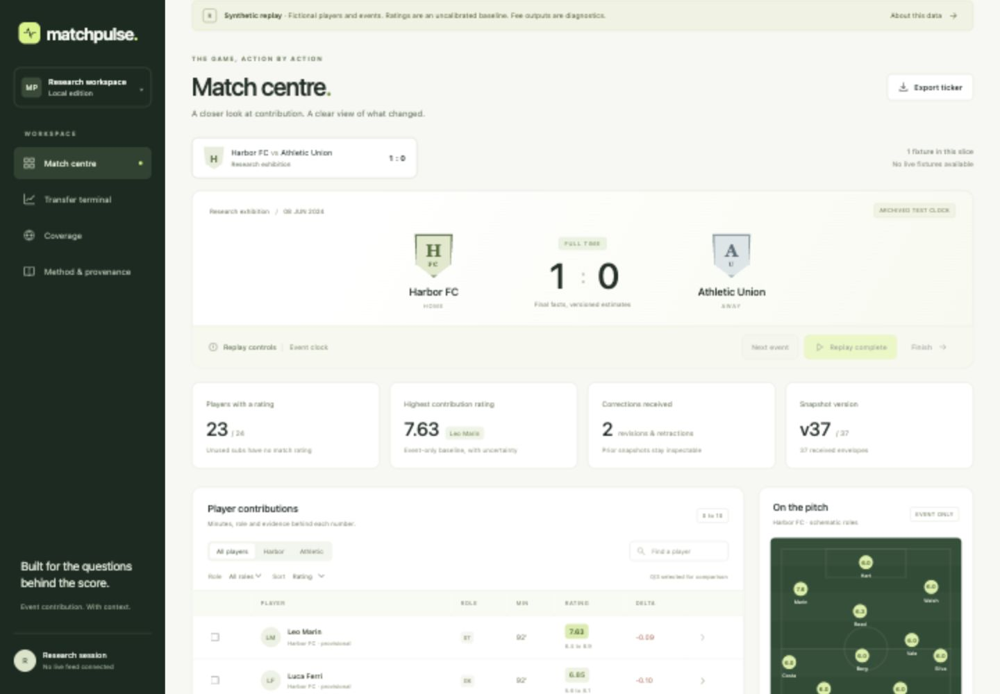

# Matchpulse

A local football contribution and transfer research terminal. Python owns the original numerical core, Go serves HTTP and resumable SSE, SQLite preserves event/revision history, and TypeScript renders the interface.

**This is a runnable diagnostic build. The full project brief is incomplete.** No actual licensed live feed, large linked research corpus, empirical model calibration or Europe-wide roster completeness is claimed. [Build status and remaining gates](docs/BUILD_STATUS.md).

```sh
make bootstrap
make build
make test
make live-demo
```

Open `http://127.0.0.1:8777`. Requires Python 3.13+, Go 1.25 and Node 24. `make docs` uses pinned WebAssembly Graphviz installed by bootstrap. No external feed, paid service or downloaded model is needed for the authored replay. Linux CI exercises the same Python/Go integration.



The screenshot is from the functioning local application with fictional players and events. It is not an actual live fixture.

Select Finish, then Next event. Inspect the goalkeeper save, dismissal, VAR reversal and revised role. Compare saved v28 with v30, then inspect v37 full time. Transfer terminal publishes 23 eligible fictional estimates and displays the later fictional sale separately. CSV retains mode, target, model ID and known-at time. [Complete walkthroughs](docs/WALKTHROUGHS.md).

The implemented core includes validated multi-clock envelopes, audited identity/registration assertions, append-only journal and snapshots, retractions, sparse exposure, post-match estimate versions, unavailable states, exactly-once derived publication within one transaction, durable reconnect and bounded worker restart. It is independent of Touchline. The reference reducer replays only the affected fixture and is not yet an optimized incremental production engine.

Original masked recurrent and dense distributional models train from random initialization in a separate synthetic diagnostic. Analytic gradients, censoring likelihoods and held-out inference have independent checks. These learned diagnostics are not promoted into served actual-player estimates. The display model and its uncertainty band remain explicitly uncalibrated. A conditional fee estimate is not a quoted price or an observed transaction.

```sh
make demo
make train RUN_ID=training-001
# Recover an interrupted existing run:
# make train RUN_ID=training-001 RESUME=1
python3 -m matchpulse.verify_training evidence/training-001
make acceptance RUN_ID=engineering-001 PROFILE=diagnostic
make verify EVIDENCE=evidence/engineering-001
make negative-controls EVIDENCE=evidence/engineering-001 RUN_ID=controls-001
make stress RUN_ID=http-001
make valuation-audit INPUT=fixtures/official-deals.json
```

Use a new run ID each time. The engineering pilot measured 1.3653 ms p95 backend processing over 592 synthetic deliveries. The concurrent loopback pilot measured 25.4123 ms p95 roundtrip with 16 callers and eight reconnecting clients. These are short local diagnostics, not upstream freshness or full acceptance. The fee learner lost to its baseline in one retained seed. [Methods, source identities and limits](docs/BENCHMARKS.md).

`make acceptance RUN_ID=full-001 PROFILE=full`, `make data` and `make release` return nonzero while required acquisition and research work is unavailable. They never silently substitute a smaller successful workload. Operator-authorized local archive files can use [the importer](scripts/import-archive.py); external source rights do not inherit the code license.

[Architecture and 12 editable diagrams](docs/ARCHITECTURE.md) · [Schema and numerical contracts](docs/CONTRACTS.md) · [Model card](docs/MODEL_CARD.md) · [Source rights](docs/DATA_RIGHTS.md) · [Evidence format](docs/ARTIFACTS.md) · [Reproduction](docs/REPRODUCIBILITY.md) · [Recovery](docs/RECOVERY.md) · [Claim index](docs/CLAIMS.md) · [Architecture decisions](docs/adr/001-storage.md)

[Operator paths](docs/OPERATIONS.md) cover source context imports, historical value comparison, UTC cutoffs, complete CSV provenance and exact epoch resume. The drawer now distinguishes contract/registration/availability support from journal events and preserves source conflicts. All shipped examples remain fictional.
